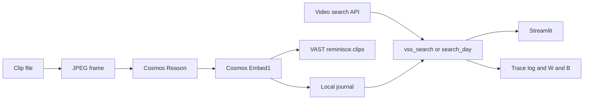

# My Day

Make every day count.

My Day is a daily memory journal for an older adult living alone, or living with early memory change. They keep short clips of the day. They can ask "did I have lunch today?" and get that clip back, with a short answer that cites the clip. They choose what a carer can see. Nothing is shared until they tap **Send**.

This is a Streamlit app for the Builders Challenge. It calls NVIDIA Cosmos Reason and Cosmos Embed1, stores clip rows in VastDB schema `reminisce`, table `clips`, and uses CoreWeave / Weights & Biases serverless inference for clip selection. The Streamlit UI is the product.

The ten practice clips are synthetic title cards generated on the machine that builds them. They are not recordings of a real person, and they are not patient data. Upload a clip you have consent to use when you want a real moment in the journal.

## What a person can do

- Add a clip by uploading a file, or record 8 seconds when this computer has a camera.
- See the day as a thumbnail gallery: a 2×2 grid of four previews. Each preview is a frame labelled with the part of the day (Morning, Afternoon, or Evening) and the time. **Play** opens that clip. **Back** and **Next** move through further pages of four.
- Ask a question in a text box, or upload a short voice question (Canary transcribes it when the speech model is up). Ask is connected to CoreWeave / W&B serverless inference at `https://api.inference.wandb.ai/v1`. The model is `meta-llama/Llama-3.1-8B-Instruct` unless `REMINISCE_LLM_MODEL` is set. The page shows `Connected to` that model when the reply came from it.
- Read a grounded answer that quotes the Cosmos description and names the `clip_id` (`Source: clip_id`).
- Play the clip the answer came from.
- Under the answer, see search results: other saved clips that match, then the shared camera archive grouped by video, each with the time of the best moment, the place, the camera, the match score, and **Play**. Phrases like `in new york` or `this week` become filters. **Filters** also offers time, place, camera, kind, and object. **Show more** fetches up to 50 results.
- Send one clip to a carer, or take it back.
- Play a short story of three to five clips. The sentences are the clip descriptions, in time order.

The main row has three tabs: **My day**, **Ask**, and **Story**. **Eval** is a small button at the top of the page. The carer view in `frontend/views/carer.py` is not in the main row.

## What this build does not do

No passive camera. No facial recognition. No medical advice. No safety-alarm framing. No accounts. No mobile app. The shared VSS collection (`vss-collection`) is not modified, and clips are not uploaded into the team's chunks bucket, so the shared ingest pipeline is not triggered.

## How an answer stays tied to a real clip

1. Ask logs in to the video search API and calls `POST /api/v1/search` with the question, `top_k` 5, and `min_similarity` 0.15. The JWT stays in memory. A hit that names a journal `clip_id` is played from that clip. Otherwise Ask uses the local cosine rank (`search_day`): Cosmos Embed1 plus activity tags. Practice clips live in VastDB schema `reminisce`, table `clips`, so this is the usual path for them. Only when the journal has no match does Ask use an archive-only hit, and only at similarity 0.3 or above. The shared archive is public street and warehouse footage, so a weaker hit would show a stranger's street as her memory. The trace field `retrieval_path` is `vss` or `journal`.
2. The W&B model may only pick ids from that short list. Two prompts are compared in the eval: `strict` and `warm`. The app uses `warm`. The eval script still ranks the journal directly so those counts stay about the embeddings.
3. The sentence on screen is the description plus `Source:` and the id. That id is the journal `clip_id` when the hit matches one, otherwise the segment or source id returned by search. The model's free text is kept in the trace and the eval file. It is not shown as the memory.
4. If the model names an id that was not retrieved, that id is dropped. If it names nothing usable, the top retrieved clip is cited instead. If nothing was retrieved, the answer is "I couldn't find that moment in your day." and it cites nothing.
5. `get_clip` loads the row again before the sentence is built. `daily_digest` includes only clips whose `shared_with` contains the carer.

## How search on Ask works

Ask makes one archive search call. Its hits feed the grounded answer above and the result list below, and the result list skips anything the answer already shows.

1. `parse_query` lifts a time phrase (`last hour`, `today`, `this week`, `this month`) and a place name from `/api/v1/metadata/schema` out of the words. Cameras, kinds, and objects come only from **Filters**, because words like `traffic` or `person` are usually what is being searched for.
2. Saved clips: `find_clips` keeps a clip only when a search word shares a stem with its tags or Cosmos description, then orders by Embed1 cosine. Some title-card embeddings sit near every query, so cosine alone never admits a clip. The time window applies. Place, camera, kind, and object filters do not, because journal clips have none.
3. Camera archive: `POST /api/v1/search` with `time_filter` (or a `custom` 30-day range) and `metadata_filters`. The page shows `chunk_results`: one card per video, pointed at its best segment. **Play** downloads that segment through `/api/v1/videos/stream` on the server, so the JWT never reaches the browser.
4. `llm_synthesis` is shown only inside **What the search model says**, labelled as model text. It is never used as a memory.
5. Every search writes a `search` row to `data/journal/traces.jsonl` with the words, filters, ids shown, and latency.

## Architecture



| Layer | What it is |
| --- | --- |
| Capture | Upload, or an 8 second camera recording. Practice clips are 6 second title cards. |
| Understanding | Cosmos Reason describes one frame from the clip. |
| Index | A 256-number Embed1 vector of that description, stored on the clip row in VastDB schema `reminisce`, table `clips`. |
| Agent | Video search first, then the local journal rank. W&B serverless inference selects ids from that list. The tools are `vss_search`, `search_day`, `get_clip`, and `daily_digest`. |
| UI | Streamlit, under `frontend/`. 2×2 thumbnail gallery, ask, search, story, carer share, eval. |
| Observability | `data/journal/traces.jsonl` for every ask, story, and digest. `scripts/run_eval.py` writes `data/journal/eval_latest.json` and a W&B table. |

Ask posts to `https://api.inference.wandb.ai/v1`. The chat model defaults to `meta-llama/Llama-3.1-8B-Instruct`. Override it with `REMINISCE_LLM_MODEL`. Cosmos Reason, Cosmos Embed1, and Canary are reached through `COSMOS3_REASON_URL`, `COSMOS_EMBED1_URL`, and `CANARY_1B_URL`. The model id for Cosmos and Embed is read from each server's `/v1/models`.

Credentials stay in the environment. The app reads them there. Do not copy keys, tokens, or host names into this folder.

## Data model

Each clip row:

```json
{
  "clip_id": "clip_001",
  "owner_id": "user_123",
  "recorded_at": "2026-10-17T12:30:00+01:00",
  "duration_s": 6.0,
  "cosmos_description": "A frame with the words Lunch and Soup at the kitchen table.",
  "activity_tags": ["lunch", "soup", "kitchen"],
  "embedding_id": "emb_clip_001",
  "shared_with": [],
  "source_citation": "clip_001",
  "media_relpath": "data/clips/clip_001.mp4",
  "description_source": "cosmos"
}
```

`source_citation` is the same id as `clip_id`. `description_source` is `cosmos` or `fallback`. A fallback caption is the on-screen label, and the UI says so. The embedding itself lives in the journal and in VastDB as `embedding_json`. It is not shown in the UI.

VastDB keeps every write. The newest `inserted_at` for a `clip_id` is the current row, so Send inserts a new row rather than editing the shared VSS tables.

## Repository

```text
frontend/app.py            Streamlit entry
frontend/style.py          Blank Street palette
frontend/views/            My day, Ask (with search results), Story, Eval
app.py                     Same entry, for the previous command
reminisce/catalog.py       Ten questions and the practice-clip labels
reminisce/media.py         ffmpeg: title cards, frames, upload, camera
reminisce/models.py        Cosmos, Embed1, Canary, W&B chat
reminisce/ingest.py        One clip in, one row out
reminisce/vast_index.py    reminisce.clips in this team's bucket
reminisce/vectors.py       Cosine rank and tag fallback
reminisce/vss_search.py    Login, filters, POST /api/v1/search, segment download
reminisce/agent.py         vss_search, search_day, find_clips, get_clip, daily_digest, story
reminisce/evaluate.py      Ten-question comparison of two prompts
scripts/check_stack.py     Probe the services, print no secrets
scripts/make_sample_clips.py
scripts/index_clips.py
scripts/run_eval.py
tests/test_reminisce.py    Grounding, search fallback, and share rules, no network
```

The labelled questions:

| Question | Clip |
| --- | --- |
| did I have lunch today? | clip_001 |
| when did my daughter visit? | clip_002 |
| when did I last go for a walk? | clip_003 |
| did I take my medication this morning? | clip_004 |
| did I have breakfast? | clip_005 |
| did anyone phone me today? | clip_006 |
| was I in the garden? | clip_007 |
| did I watch television? | clip_008 |
| did I rest this afternoon? | clip_009 |
| did I open the front door? | clip_010 |

## Commands

Run these one at a time from the cloned repository. Each block is a single command. Do not join them with `&&`.

Clone the repository:

```bash
git clone https://github.com/prkshverma09/MyDay.git
```

```bash
cd MyDay
```

Install the Python virtualenv packages if `python3 -m venv` is not already available:

```bash
sudo DEBIAN_FRONTEND=noninteractive apt-get update
```

```bash
sudo DEBIAN_FRONTEND=noninteractive apt-get install -y python3.12-venv python3-pip
```

Create the virtualenv and install the app libraries:

```bash
python3 -m venv .venv
```

```bash
.venv/bin/pip install -r requirements.txt
```

Check Cosmos, Embed1, Canary, W&B, and VastDB. The command prints status lines only.

```bash
.venv/bin/python scripts/check_stack.py
```

Create the ten practice clips:

```bash
.venv/bin/python scripts/make_sample_clips.py
```

Describe them with Cosmos, embed the descriptions, and write VastDB:

```bash
.venv/bin/python scripts/index_clips.py
```

Run the unit tests:

```bash
.venv/bin/python -m unittest discover -s tests -v
```

Run the ten questions twice, once for each prompt, and log the table to W&B:

```bash
.venv/bin/python scripts/run_eval.py
```

Start the app. Leave this command running.

```bash
.venv/bin/streamlit run frontend/app.py
```

Open `http://127.0.0.1:8501`.

To describe a single practice clip again:

```bash
.venv/bin/python scripts/index_clips.py --clip clip_001 --force
```

## Eval

`scripts/run_eval.py` asks all ten questions with both prompts. It prints counts.

- **Embedding retrieval:** the description vector alone ranked the labelled clip first.
- **Hybrid retrieval:** the same rank, with an activity-tag bonus when a tag word is in the question. This is what `search_day` uses. Target: 8/10 or better.
- **Raw selection:** the W&B reply contained the labelled `clip_id` before the safety fallback. This is the prompt comparison.
- **Served:** the sentence the person would see cites the labelled clip.
- **Grounded:** that sentence includes the real Cosmos description and a real `clip_id`, and no other `clip_id`. Target: 10/10. The script exits with status 1 if either prompt misses this.
- **Hallucinations:** `clip_id`s in the raw model text that are not in the journal. They are counted and then dropped. They are not served.
- **Latency:** mean seconds per question, including the embedding call and the W&B call.

The same numbers are on the Eval page. W&B receives a table named `results` and the summary counts. The run URL is printed as `wandb: ...` and stored in `data/journal/eval_latest.json`.

## Demo, about three minutes

1. **My day.** Show lunch, the walk, and the visit in the 2×2 gallery. Say that these practice clips stand in for a consented recording, and that unshared clips stay here.
2. **Ask.** Type `did I have lunch today?` and play the clip under the answer. Point at `Source: clip_001` and the connected model line.
3. **Search.** Ask `a person walking a dog in new york`. The answer says it is not in her day, and the camera archive below shows New York videos. Play one.
4. **Eval.** Show hybrid retrieval, grounded answers, and the W&B line.
5. Close on control: she shares what she wants, when she wants.

## Use a real consented clip

Record it yourself, 5 to 30 seconds, mp4 or webm, under 25 MB. In **My day**, tap **New clip**, add activity words such as `walk`, upload the file, and tap **Add**. The same Cosmos, embed, journal, and VastDB path runs. Do not upload someone else's medical or care footage.

## When something fails

- `check_stack.py` exits 1: read the failing line. Cosmos and Embed must be `ok` before indexing. Canary can fail; typing a question still works.
- Cosmos descriptions look generic: run `.venv/bin/python scripts/index_clips.py --force` and read the one-line description printed for each clip. If a line says `fallback`, that clip did not get a Cosmos description.
- Retrieval is under 8/10: the Eval table shows `embedding` and `hybrid` for each question. Hybrid is allowed to use the activity tags as a fallback. Say the real count in the demo.
- VastDB did not mirror: the journal still works. `data/journal/vast_status.json` has a redacted reason. Re-run `scripts/index_clips.py --force` after VastDB is reachable.
- Voice upload does nothing useful: Canary is optional. Type the question.

## Privacy

The older adult owns the clips. Send is per clip. Take it back removes the carer from `shared_with` and writes that row to VastDB. The daily note is off until the switch on the Carer page is on, and even then it only summarises clips already sent. There is no background recorder.

## Also in this repository

The Streamlit journal above is the app. These folders are separate tools already on `main`:

- `video-chunker/` cuts one local video into timed mp4 chunks.
- `pipeline/` writes 5-second Cosmos Reason and YOLO descriptions for a later language-model step. It does not call that model.
- `library/example-descriptions/` holds sample window annotations for that later step.
